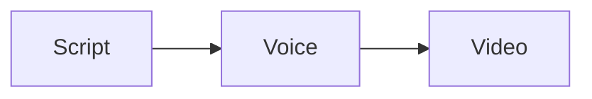

# script2video script syntax (implemented subset)

## Frontmatter

```yaml
---
title: Google Web Font 로드 최적화        # video title (description draft)
lang: ko                                  # ko | ja | en — one language per file
cast:                                     # speakers, in order (the first is the default)
  host:
    voice: "qwen:Sohee"                   # qwen:<speaker> | persona:<id> | supertonic:<F1-F5|M1-M5>
    style: "차분하고 친근한 설명 톤"          # qwen voices only: speaking style
    speed: 1                              # 0.5–2
    name: 소희                             # shown in subtitles / name tags
    color: "#2563EB"
    draftVoice: "supertonic:F1"           # voice for `render --draft`
    character: ../characters/sohee        # or { dir: ..., facing: left|right|front }
    face: neutral                         # default face
    side: left                            # left | right (dialogue / characters)
    avatar: assets/sohee.png              # circle avatar when there is no character art
outputs:
  youtube: { aspect: "16:9", layout: presenter }        # presenter | dialogue | shorts
  shorts: { aspect: "9:16", layout: shorts, scenes: [problem], maxDuration: 60 }   # shot: full ignores ::shot here
  # subtitles: sentence | word   (word is the default for the shorts layout)
pronounce:                                # display text → what TTS reads (ko/ja)
  Preload: 프리로드
pacing: { sentenceGap: 0.3, paragraphGap: 0.6, sceneGap: 0.8, lead: 1.3, tail: 3.0, maxPause: 0.35 }
targetDuration: 300                       # seconds; lint warns beyond ±15 %
subtitleStyle:                            # optional; also per output: outputs.<name>.subtitleStyle
  size: 1.1                               # text size factor
  position: bottom                        # bottom | middle | top
  color: "#ffffff"
  background: "rgba(0,0,0,0.6)"           # or none (outlined text)
  highlight: "#facc15"                    # word subtitles
  font: assets/MyFont.ttf                 # null = bundled Noto Sans (missing glyphs fall back to it)
bgm: { src: assets/music.mp3, credit: "Title — Artist (CC0)" }   # looped, ducked under speech
  # level: -30 (LUFS of the music alone), duck: true
sfx: auto                                 # whoosh on visuals, pop on marks, click on highlights
transition: fade                          # dip to background between scenes (or per output)
theme: dark                               # light | dark | { base: dark, accent: "#22d3ee", background: …, text: … }
logo: { src: assets/logo.png, position: top-right, size: 0.08 }   # corner logo
translationOf: script.ko.md               # translations only
---
```

## Scenes and visuals

~~~markdown
# Scene title {#scene-id}

::title[Big title card]

::image{src=assets/screen.png}

:::bullets
- first point
- second point
:::

:::code
```html
<link rel="preload" href="style.css" as="style">
```
:::

:::table
| 속성 | 이유 |
| --- | --- |
| `display: inline-block` | 내용에 맞춰 너비 결정 |
| `float` | shrink-to-fit |
:::

:::quote{by="MDN"}
인용할 문장입니다.
:::

::thumbnail{src=assets/thumb.png}

:::compare
### Before
- slow
### After
- fast
:::

:::gallery
  
:::

:::chart{unit=ms}
| resource | time |
| --- | --- |
| fonts | 790 |
| css | 300 |
:::

::video{src=assets/clip.mp4 start=2}

:::markdown
## A text card
Paragraphs with **bold** and `code`.
- list items
:::

:::split{side=right}


## Text beside the image
- points
:::

:::diagram

:::
~~~

`::thumbnail` is not shown in the video; render uses it for `<output>.<lang>.thumbnail.png`
(otherwise a still of the first scene).

A visual stays on screen until the next one in the scene. Paragraphs after a visual are the
narration shown over it.

## Character framing

A layered character (a folder with `character.yaml`, generated or hand-drawn) can be drawn
full-length (`full`, the default), from the waist up (`upper`) or as a head close-up (`head`).
`::shot` on its own line before the scene's first paragraph sets it for that scene; cast members
not named keep the previous scene's framing (the video starts full):

```markdown
# 만드는 법 {#how}

::shot{mina=head joon=upper}
```

`::shot{mina=full}` goes back. Not inside paragraphs. A framing shows only the faces of its set
(`sets.upper` / `sets.head` in the yaml; `s2v character missing <script> --apply` adds them).
Imported YMM4 characters have only `full`.

Faces of a layered character are the names under `faces:` in its yaml. With
`preset: standard@1`: `neutral happy sad angry surprised anxious excited calm serious puzzled
moved playful` (turned toward the other speaker), `front-<expression>` (to the viewer),
`glance-neutral glance-surprised glance-happy glance-puzzled` (head turn only), and the poses
`wave point akimbo cheer arms-crossed hands-together`; in the head close-up `neutral happy sad
surprised moved serious`.

## Narration

- A paragraph is narration; sentences split at `.`, `?`, `!` (ja: `。！？`).
- `key: text` — the speaker (`cast` key). `key{gap=-0.2 face=happy}: text` — start 0.2 s early
  (overlap) / face for this paragraph.
- `:cue[spoken phrase]{...}` — when the phrase is spoken:
  - image: `x=0.38 y=0.06 zoom=2 mark=circle r=0.035` or `mark=box w=0.2 h=0.07`
    - other marks: `mark=highlight w= h=` (marker pen), `mark=spotlight` (`r=`, or `w= h=`;
      darkens the rest), `mark=arrow from=left|right|top|bottom` (tip at x, y)
    - `show=assets/next.png` switches to another image from that word (crossfade)
    - an image without zoom/x/y cues drifts slowly (Ken Burns); `::image{src=… kenburns=off}`
  - code: `line=3` or `line=2-4`
  - bullets: `highlight=0` (0-based item)
  - table, chart: `row=2` or `row=2-3` (1-based body rows)
  - compare: `highlight=1` (0-based column); gallery: `highlight=2` (0-based image)
  - diagram: `node=B` (flowchart node id); markdown / split: `highlight=1` (0-based block)
- `sfx=pop|click|whoosh|ding|none` on any cue — that effect (none: silence the automatic one).
- Acting: `key{emo=sad power=weak say="as if to herself" volume=soft speed=0.9}: text`.
  - `emo`: `neutral happy sad angry surprised anxious excited calm serious puzzled moved playful`
    or a name from `acting.emotions` in the frontmatter (`sleepy: { voice: "Sound drowsy.",
    face: calm, motion: none, speed: 0.8, maxPause: 1.5 }`). It sets the voice (Qwen preset
    speakers), the character's face of that name (default face when it has none) and a motion.
  - `power=weak|strong` needs `emo`. `say="…"`: a free direction (Qwen preset speakers; no quotes
    or `}` inside). `volume=soft|loud`: −6 / +3 dB. `speed=0.8–1.25`: times the cast speed.
  - `:emo{emo=sad}` between two sentences changes them from the next sentence to the paragraph
    end (it replaces all of emo/power/say/volume/speed). Not inside a sentence.
  - Only on lines whose words carry the emotion: an instruction does not make a plain sentence
    happy (it can sound wrong). Persona and Supertonic voices do not act emotions.
  - Keep the prefix on one line: `key{…}: text`.
  - No sighs, breaths or gasps: do not write them as text ("하아…", "ah…"); the voice misreads
    the line. Show the feeling with `emo` and the words instead.
- `:pause[0.8]` — extra pause after the sentence (seconds).
- `:only{youtube}` — this paragraph only in the listed outputs.
- `:audio{src=rec/intro.wav}` — this paragraph is your own recording (≤ 180 s) instead of TTS;
  it is aligned to the text and cut into sentences, so cues and subtitles work the same.
- `:react{minsu=surprised jiwoo=happy}` — listeners' faces from the next word to the paragraph
  end (characters only). `minsu=surprised+shake` picks the motion, `+none` turns it off.
- Motions (characters): a face change brings one automatically — surprised → jump, happy →
  bounce, angry → shake, sad → sink. Pick another with `key{face=… motion=nod}:` (jump, shake,
  nod, bounce, shiver, sink, lean) or `motion=none`; `motion: off` on a cast member turns the
  automatic ones off for that character.
  Layered characters also have `head-nod` and `head-tilt` (the head only); a face's motion can
  be set in its yaml. Where there is no separate head (YMM4 material, the head close-up) they play
  as `nod` and `lean`.

## Commands

```sh
node packages/cli/dist/main.js lint   <script>          # static checks (also length estimate)
node packages/cli/dist/main.js check  <script>          # subtitle overflow, real layout
node packages/cli/dist/main.js say    "문장" --script <script>    # hear one sentence (its voice + dictionary)
node packages/cli/dist/main.js pick   <image>           # click/drag → cue attributes
node packages/cli/dist/main.js render <script> --output youtube [--draft]
node packages/cli/dist/main.js snapshot <script> --output youtube
node packages/cli/dist/main.js sentences <script>        # sentence ids
node packages/cli/dist/main.js export-script <script>    # reading script for :audio recordings
node packages/cli/dist/main.js import-recording <script> take.wav --write   # one take → paragraphs
node packages/cli/dist/main.js dev    <script> [--video]  # edit loop on every save
node packages/cli/dist/main.js tts    <script> --retry problem:2:0   # new takes for one sentence
node packages/cli/dist/main.js new    videos/<id> --lang ko          # starter folder + script
node packages/cli/dist/main.js doctor                                # environment check
node packages/cli/dist/main.js voice create voices/<id>.yaml --lang ko --candidates 4
node packages/cli/dist/main.js character missing <script> [--apply]   # faces the characters lack
node packages/cli/dist/main.js voice pick   voices/<id>.yaml <n> --lang ko
```
